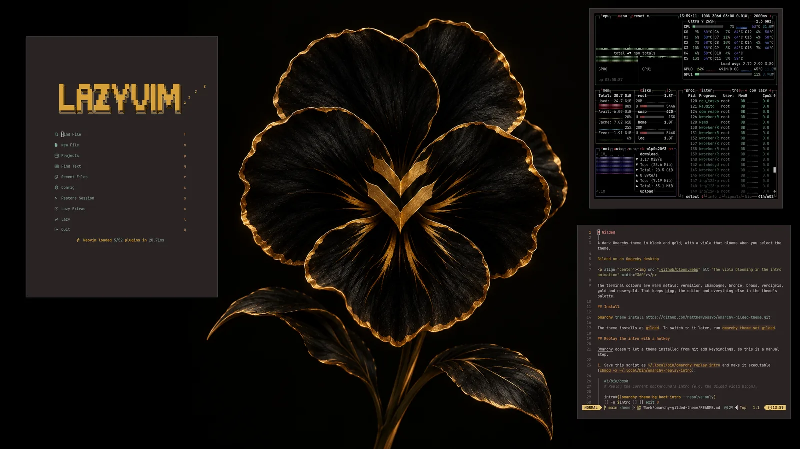

# Gilded

A dark Omarchy theme in black and gold, with a viola that blooms when you select the theme.



<p align="center"></p>

The terminal colours are metals: vermilion, champagne, bronze, brass, verdigris, steel and rose-gold, with gold as the accent. That keeps btop, the editor and everything else in the theme's palette.

## Install

```bash
omarchy theme install https://github.com/MatthewBoss96/omarchy-gilded-theme.git
```

The theme installs as `gilded`. To switch to it later, run `omarchy theme set gilded`.

## Replay the intro with a hotkey

Omarchy doesn't let a theme installed from git add keybindings, so this is a manual step.

1. Save this script as `~/.local/bin/omarchy-replay-intro` and make it executable (`chmod +x ~/.local/bin/omarchy-replay-intro`):

   ```bash
   #!/bin/bash
   # Replay the current background's intro (e.g. the Gilded viola bloom).

   intro=$(omarchy-theme-bg-boot-intro --resolve-only)
   [[ -n $intro ]] || exit 0

   # Decode offscreen first, as a theme switch does, so playback starts without a stutter.
   owe intro-prepare "$intro" >/dev/null 2>&1
   exec owe intro --start still --refresh "$intro"
   ```

2. Add this line to `~/.config/hypr/bindings.lua`, replacing `<you>` with your username. The full path is there because Hyprland may not have `~/.local/bin` on its `PATH`.

   ```lua
   o.bind("SUPER + CTRL + ALT + I", "Replay background intro", "/home/<you>/.local/bin/omarchy-replay-intro")
   ```

3. Press `SUPER + CTRL + ALT + I`. The intro replays and settles back on the wallpaper. The script works with any background that has an intro, not only Gilded. On a background without one, the key does nothing.

## Contents

- `colors.toml`: the colour palette. Omarchy builds the terminal, editor and app themes from it.
- `backgrounds/1-gilded-viola.png`: the 3840x1600 wallpaper.
- `backgrounds/intros/1-gilded-viola.mp4`: a 6 s, 60 fps intro that plays when the theme is selected, ends in bursts of gold sparkles and fades into the wallpaper.
- `icons.theme`: sets the Yaru-yellow icon theme.
- `unlock.png` and `preview-unlock.png`: the gold Omarchy logo for the boot screen where you unlock your disk, and its preview. Select it with `omarchy plymouth switcher`.
- `preview.png`: the screenshot the Omarchy theme picker shows.
