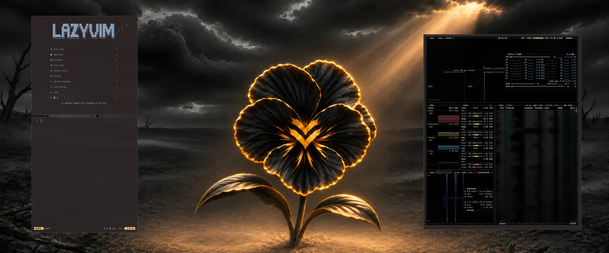

# Gilded

A dark Omarchy theme in black and gold, with a viola that blooms when you select the theme.



<p align="center"></p>

The terminal colours are metals: vermilion, champagne, bronze, brass, verdigris, steel and rose-gold, with gold as the accent. That keeps btop, the editor and everything else in the theme's palette.

## Install

```bash
omarchy theme install https://github.com/MatthewBoss96/omarchy-gilded-theme.git
```

The theme installs as `gilded`. To switch to it later, run `omarchy theme set gilded`.

## Replay the intro with a hotkey

Omarchy doesn't let a theme installed from git add keybindings, so this is a manual step.

1. Save this script as `~/.local/bin/omarchy-replay-intro` and make it executable (`chmod +x ~/.local/bin/omarchy-replay-intro`):

   ```bash
   #!/bin/bash
   # Replay the current background's intro (e.g. the Gilded viola bloom).
   # Alternate intros named <wallpaper>.<variant>.mp4 take turns on each press.

   intro=$(omarchy-theme-bg-boot-intro --resolve-only)
   [[ -n $intro ]] || exit 0

   shopt -s nullglob
   intros=("$intro" "${intro%.*}".*."${intro##*.}")
   turn_file=$HOME/.local/state/omarchy-replay-intro.turn
   turn=$(( ($(cat "$turn_file" 2>/dev/null || echo 0) + 1) % ${#intros[@]} ))
   echo "$turn" >"$turn_file"
   intro=${intros[turn]}

   # Decode offscreen first, as a theme switch does, so playback starts without a stutter.
   owe intro-prepare "$intro" >/dev/null 2>&1
   exec owe intro --start still --refresh "$intro"
   ```

2. Add this line to `~/.config/hypr/bindings.lua`, replacing `<you>` with your username. The full path is there because Hyprland may not have `~/.local/bin` on its `PATH`.

   ```lua
   o.bind("SUPER + CTRL + ALT + I", "Replay background intro", "/home/<you>/.local/bin/omarchy-replay-intro")
   ```

3. Press `SUPER + CTRL + ALT + I`. The intro replays and settles back on the wallpaper. With Gilded, each press switches between the bloom and the sparkle intro. The script works with any background that has an intro, not only Gilded. On a background without one, the key does nothing.

## Contents

- `colors.toml`: the colour palette. Omarchy builds the terminal, editor and app themes from it.
- `backgrounds/1-gilded-viola.png`: the 3840x1600 wallpaper.
- `backgrounds/intros/1-gilded-viola.mp4`: the intro, a 5 s, 60 fps bloom that plays when the theme is selected, pulses with a gold glow and fades into the wallpaper.
- `backgrounds/intros/1-gilded-viola.sparkle.mp4`: an alternate 6 s intro that ends in bursts of gold sparkles. Omarchy doesn't play it by itself; the replay hotkey above takes turns between the two.
- `backgrounds/2-gilded-ashen-tulips.jpg`: a second 3840x1600 wallpaper, a black viola among gold-edged tulips in an ashen field under a golden sunbeam. Pick it with the background switcher.
- `backgrounds/intros/2-gilded-ashen-tulips.mp4`: its 5 s, 60 fps intro, where the storm clouds over a bare ashen field part, the beam breaks through and the tulips and the viola grow, ending on the wallpaper.
- `icons.theme`: sets the Yaru-yellow icon theme.
- `unlock.png` and `preview-unlock.png`: the gold Omarchy logo for the boot screen where you unlock your disk, and its preview. Select it with `omarchy plymouth switcher`.
- `preview.png`: the screenshot the Omarchy theme picker shows.
